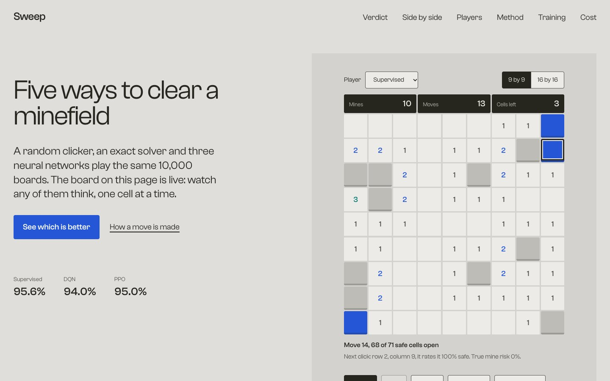

# RL Minesweeper

Five players on the same mine-grid puzzle, compared on the same 10,000 boards:

| Player | What it is |
| --- | --- |
| `random` | clicks any hidden cell |
| `solver` | exact mine probabilities by enumeration; the reference |
| `supervised` | CNN trained on the true mine positions (not RL) |
| `dqn` | double dueling DQN with action masking |
| `ppo` | PPO with action masking and GAE |

The three learners share one fully convolutional ResNet (`msrl/models.py`), so a
network trained on 9x9 also runs on larger boards.

**Live site: https://z3lka.github.io/rl_minesweeper/** (the networks run in your browser)



## Results

Each player plays the same 10,000 fixed boards. A forced guess is a loss where
no cell was provably safe and the player took the best odds; a mistake is a
loss it could have avoided.

**9x9, 10 mines**

| Player | Games won | Lost on a forced guess | Lost through its own mistake | Training time |
| --- | --- | --- | --- | --- |
| Exact solver | 96.2% | 3.9% | 0.0% | none |
| Supervised | 95.6% | 3.8% | 0.6% | 14 min |
| PPO | 95.0% | 2.6% | 2.5% | 57 min |
| DQN | 94.0% | 2.8% | 3.2% | 25 min |
| Random | 0.0% | 0.0% | 100.0% | none |

**16x16, 40 mines** (learners fine-tuned from their 9x9 weights for 10M steps)

| Player | Games won | Lost on a forced guess | Lost through its own mistake | Training time |
| --- | --- | --- | --- | --- |
| Exact solver | 87.2% | 12.8% | 0.0% | none |
| Supervised | 85.8% | 11.4% | 2.8% | 28 min |
| PPO | 82.0% | 5.6% | 12.4% | 89 min |
| DQN | 76.8% | 7.4% | 15.8% | 52 min |
| Supervised, 9x9 weights unchanged | 61.9% | 4.2% | 33.9% | none |
| PPO, 9x9 weights unchanged | 28.5% | 1.8% | 69.7% | none |
| DQN, 9x9 weights unchanged | 29.9% | 2.0% | 68.1% | none |

**DQN ablations on 9x9** (8M steps each)

| Player | Games won | Lost on a forced guess | Lost through its own mistake | Training time |
| --- | --- | --- | --- | --- |
| DQN baseline (discount 0.9, 15M steps) | 94.0% | 2.8% | 3.2% | 25 min |
| Discount 0.99 | 94.2% | 2.9% | 2.9% | 13 min |
| No per-cell reward | 93.4% | 2.8% | 3.8% | 14 min |
| 3 blocks instead of 6 | 92.0% | 2.7% | 5.3% | 8 min |
| Discount 0 | 90.5% | 3.2% | 6.3% | 13 min |

What this shows:

- The supervised network is the best learner on both boards and the cheapest to
  train. It stays within 1.4 points of the exact solver.
- The two RL agents get close on 9x9 and fall behind on 16x16. The gap is made
  of avoidable mistakes, not bad luck.
- PPO beats DQN, at about twice the training time.
- For DQN, lookahead matters most (discount 0 costs about 3.5 points); the
  per-cell reward matters least.
- The exact solver cannot reach 100%: some boards force a guess.

Everything was trained on one M4 Pro laptop (Apple GPU via MPS), 5.2 hours in
total. No agent was trained on the expert board (30x16, 99 mines); only the
solver (45.3%) and random baselines exist there.

## Run it

```sh
uv sync
uv run pytest                                   # env and solver tests
uv run python -m msrl.bench                     # throughput on this machine

uv run python -m msrl.evaluate --agent solver   # baselines -> results/<board>/
uv run python -m msrl.evaluate --agent random

uv run python -m msrl.supervised                # each writes runs/<name>/ and results/<board>/<name>.json
uv run python -m msrl.dqn
uv run python -m msrl.ppo

uv run python -m msrl.export_web                # ONNX models + results.json for the site
cd web && pnpm install && pnpm dev              # the showcase site
```

Every trainer takes `--board beginner|intermediate|expert`, `--env-steps`, `--name`
and `--init <checkpoint>` (fine-tune from another board size).

## Rules of the environment

- The only action is revealing a cell; flags are not needed to win.
- Mines are placed on the first click so the clicked cell and its neighbours are
  empty, which always opens a region.
- Reward: a share of 1.0 for each newly opened cell, +1 for a win, -1 for a mine.

## How results are judged

`msrl/evaluate.py` plays 10,000 fixed boards per player. Each lost game is
classified by the exact solver as a `blunder` (a provably safe cell existed),
a `bad_guess` (had to guess, chose worse odds than the best) or `unlucky`
(took the best odds and lost).

## Layout

```
msrl/        environment, solver, network, trainers, evaluation, export
tests/       pytest suite
results/     committed evaluation summaries and training curves
docs/        README screenshot
runs/        checkpoints and logs (ignored)
web/         Vite + React site; game logic and solver ported to TypeScript
```

## Licence

MIT. See `LICENSE`.
